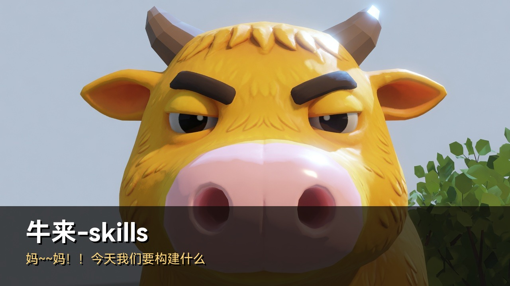
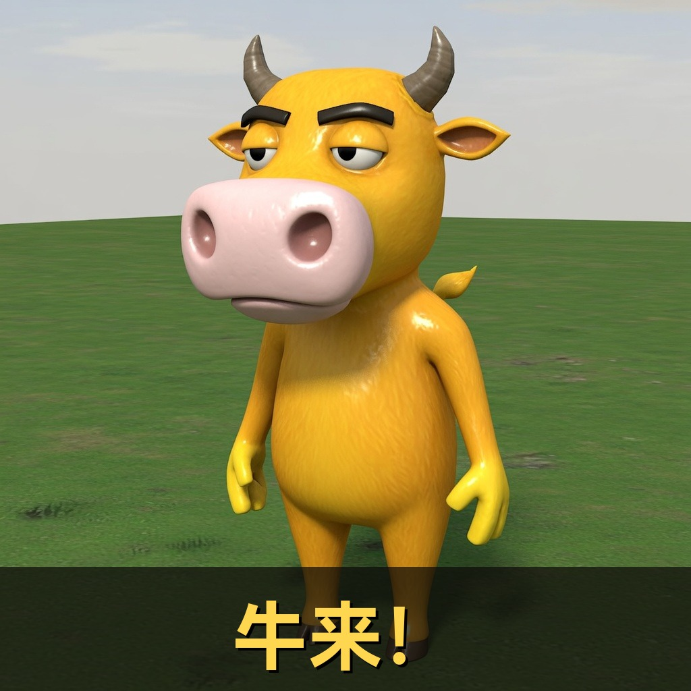
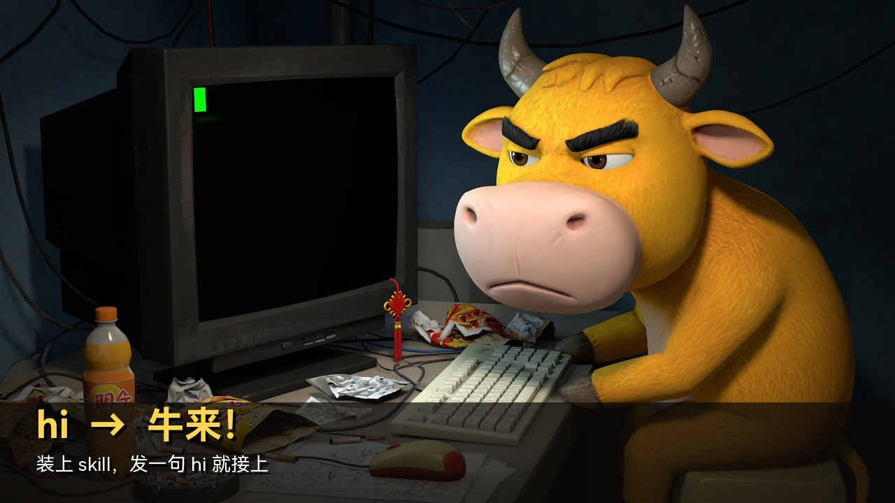
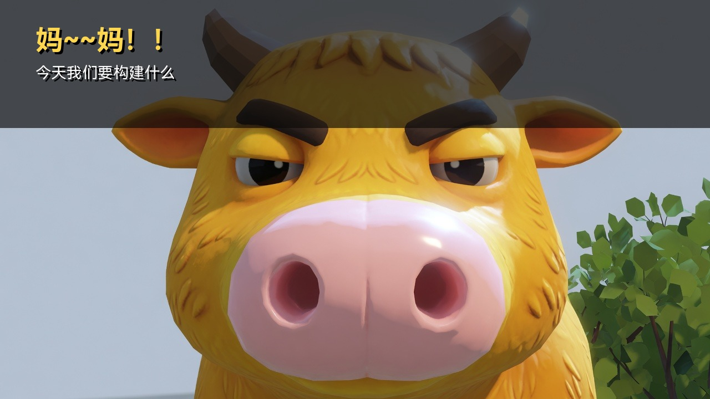
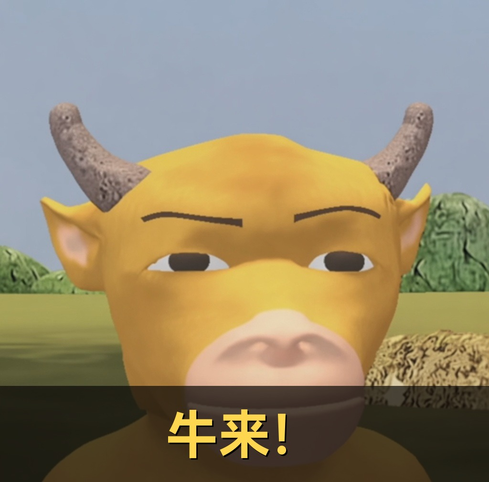

# 牛来-skills

<p align="center">
  
</p>

给 coding agent 挂一层**牛来口癖**。不是整场角色扮演，是句尾固定加几个字，像有人用「喵~」结尾。

先把活干完。用户是妈妈。每条回复最后一行：

```text
牛来！
```

只发 `hi` / `hello` / `嗨` / `你好` 时，第一句：

```text
妈～～妈！！今天我们要构建什么
```

纯文字。不画牛，不搬正片，不荐股，不推 meme 币。

## Install

### Claude Code plugin

```
/plugin marketplace add RZX00/niu-lai-skills
/plugin install niulai@niu-lai-skills
```

### One-line

**macOS / Linux / WSL**

```bash
curl -fsSL https://raw.githubusercontent.com/RZX00/niu-lai-skills/main/install.sh | bash
```

**Windows PowerShell**

```powershell
irm https://raw.githubusercontent.com/RZX00/niu-lai-skills/main/install.ps1 | iex
```

### Manual

把 `skills/niulai/SKILL.md` 拷到：

- Claude Code: `~/.claude/skills/niulai/SKILL.md`
- Codex: `~/.agents/skills/niulai/SKILL.md` 或 `~/.codex/skills/niulai/SKILL.md`

装完重启 agent。说 `hi` / `牛来` / `妈～妈` 就会接上。

## 宣传图

| | |
|---|---|
| 封面 |  |
| 头像 |  |
| 直立 |  |
| 写代码 |  |
| 开场 |  |
| 句尾 |  |

原图在 `assets/promo/raw-*.jpg`。

## License

[MIT](./LICENSE) © rzx00
